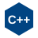

<p align="center">
  
</p>

## Who is Eva?

```js
const eva_safi = {
  bio: "Software engineering student in Istanbul. I like measuring what privacy and AI do to people.",

  education: {
    BSc: "Software Engineering @ Üsküdar University (expected 2027)",
  },

  research: [
    "Privacy-enhancing technologies",
    "Algorithmic fairness",
    "Explainable ML",
    "EEG and neuroimaging",
  ],

  volunteering: {
    "Tribe-X (Tech for Palestine)": "Volunteer researcher, Kenzy ethical-scoring framework",
  },

  openSource: [
    "Trusted-AI/AIF360 (open PRs)",
    "MNE-Python (open PR)",
    "The Turing Way (merged docs PR)",
  ],

  tech: ["Python", "SQL", "JavaScript", "PyTorch", "scikit-learn", "Opacus", "MNE-Python", "Power BI"],

  currently: [
    "Studying how differentially private training changes group fairness",
    "Scoring digital tools for Kenzy",
  ],
};
```

## Connect with me

<p>
  <a href="https://github.com/evasafi"></a>
  <a href="https://www.linkedin.com/in/eva-s-2b4609440"></a>
  <a href="https://www.kaggle.com/evasafi"></a>
</p>

## Languages and Tools

<p>
  
  
  
  
  
  
  
  
  
  
  
  
  
  
  
  
  
</p>
